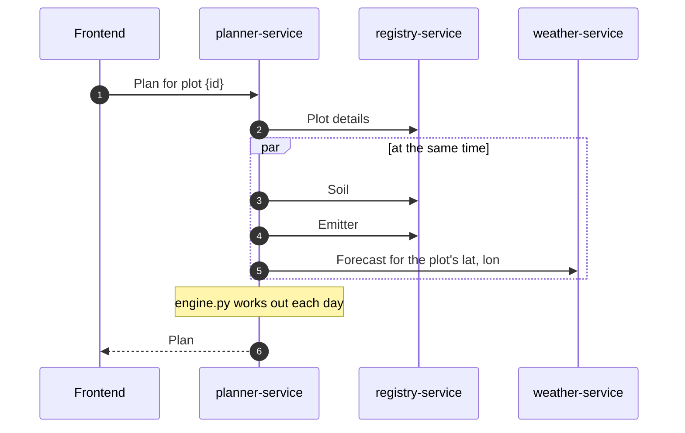
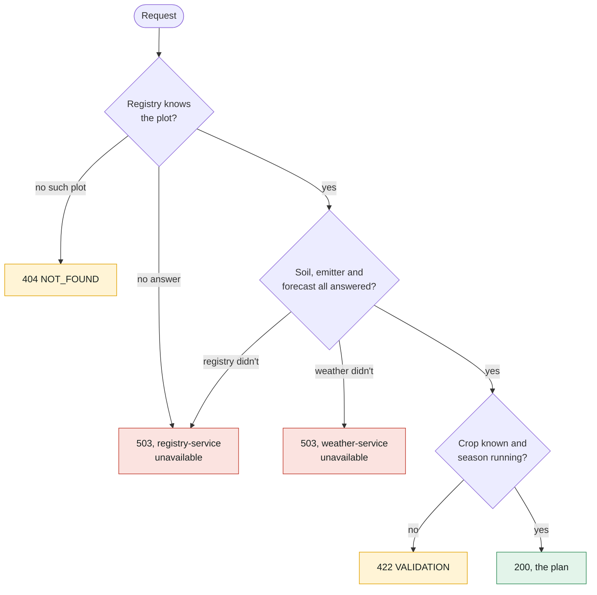

# planner-service

Answers the grower's question: **should I water this plot today, and for how many minutes?** For a plot, it combines what registry-service knows (crop, planting date, soil, emitter, spacing, area, location) with weather-service's next days (ET0, rain) into a day-by-day drip plan. Every number comes from `engine.py`, a small deterministic FAO-56 calculation; no AI model computes or adjusts anything.

## Run

Needs registry-service on port 8000 and weather-service on port 8001.

```bash
uv sync
cp .env.example .env
uv run uvicorn main:app --host 127.0.0.1 --port 8002
```

Interactive docs: http://127.0.0.1:8002/docs.

## Configuration

Read by `config.py` (pydantic-settings) from the environment or `.env` in this folder (a real environment variable wins). All required; a missing or invalid one stops startup with a message naming it.

| Variable | Example | Meaning |
|---|---|---|
| `REGISTRY_URL` | `http://127.0.0.1:8000` | registry-service base URL |
| `WEATHER_URL` | `http://127.0.0.1:8001` | weather-service base URL |
| `REGISTRY_TIMEOUT_S` | `5` | Timeout per registry call |
| `WEATHER_TIMEOUT_S` | `20` | Timeout per weather call. Must exceed weather-service's worst case (~16 s: 3 provider attempts × 5 s + 2 × 0.5 s), or a slow Open-Meteo shows up as "weather-service unavailable" |

## The method, in short

The full method, with every FAO-56 reference and a worked case, is the **AgroPilot planner method** section of the `irrigation-calc-reference` skill (`.claude/skills/irrigation-calc-reference/SKILL.md`). The engine and that section must change together.

- **Crops** (`crops.py`, FAO Tables 11/12/22, single Kc, no climate adjustment):

  | | tomato | bell-pepper |
  |---|---|---|
  | Stages (days) | 30 / 40 / 45 / 30 = 145 | 30 / 35 / 40 / 20 = 125 |
  | Kc ini / mid / end | 0.60 / 1.15 / 0.80 | 0.60 / 1.05 / 0.90 |
  | Root depth | 0.7 m | 0.5 m |
  | p (share of the bucket used before irrigating) | 0.40 | 0.30 |

- **Bucket:** size = the soil's available water (mm per m) × root depth. The plan keeps the bucket at or above `threshold_mm` (the size minus p × size).
- **This morning** the bucket is assumed to be at the threshold (there is no sensor or irrigation history).
- **Each day:** Kc for the day of the season; crop use = Kc × ET0; rain counts if it is at least 0.2 × ET0 and refills first (any excess drains); if the day's use would take the bucket below the threshold, **irrigate just enough to end the day at the threshold**.
- **Drip:** litres = depth (mm) × area (m²); run minutes = litres ÷ (number of emitters × emitter flow) × 60, where emitters = area ÷ (row spacing × emitter spacing). No efficiency factor. A run longer than 1440 minutes is shown as computed: the drip system can't keep up with that day's use.
- **Season:** day 1 is the planting day. A plot whose season has ended gets a `422` ("Season ended on …; update the planting date."). If the season ends inside the window, the plan stops at `season_end`. The demo plots in `registry-service/demo.sql` are past their season; PATCH a recent planting date to see a plan.

Check with the brief's example: 1000 m² of mid-season tomato, ET0 6.0, no rain, rows 1.5 m, emitters every 0.4 m at 1.0 L/h → 6.9 mm, **6900 litres, 248 minutes**.

## API

`GET /v1/plots/{id}/plan?days={days}` — `days` 1…7, default 7; the first day is today (local to the plot, as weather-service defines it).

```json
{
  "plot_id": "ddde51a9-9fd6-43a6-bade-c8d98e947e4b",
  "crop_id": "tomato",
  "planting_date": "2026-08-11",
  "season_end": "2027-01-02",
  "bucket_capacity_mm": 122.5,
  "threshold_mm": 73.5,
  "fetched_at": "2026-11-18T08:59:37Z",
  "stale": false,
  "days": [
    { "date": "2026-11-18", "et0_mm": 2.72, "rain_mm": 0.0, "kc": 1.15, "etc_mm": 3.13,
      "irrigation_mm": 3.13, "litres": 3128, "run_minutes": 113, "bucket_end_mm": 73.5, "stale": false },
    { "date": "2026-11-19", "et0_mm": 2.98, "rain_mm": 0.0, "kc": 1.15, "etc_mm": 3.43,
      "irrigation_mm": 3.43, "litres": 3427, "run_minutes": 123, "bucket_end_mm": 73.5, "stale": false }
  ]
}
```

(A live answer for a tomato plot planted 99 days earlier; `days=7` returns 7 entries.)

| Field | Meaning |
|---|---|
| `season_end` | Last day of the crop's season; `days` is shorter than asked only when the season ends inside the window |
| `bucket_capacity_mm` | Water the root zone holds when full |
| `threshold_mm` | Bucket level the plan keeps above |
| `fetched_at`, `stale` | From weather-service; `stale: true` means its forecast came from its cache because Open-Meteo was down |
| `days[].et0_mm`, `rain_mm` | The forecast for that day |
| `days[].kc`, `etc_mm` | Crop factor for that day of the season, and the crop's water use (Kc × ET0) |
| `days[].irrigation_mm`, `litres`, `run_minutes` | Water to apply that day; `0` when no irrigation is needed |
| `days[].bucket_end_mm` | Water left in the root zone at the end of the day |
| `days[].stale` | Same as the top-level `stale`, on every row it affects |

Rounding: Kc 3 decimals, mm 2 decimals, litres and minutes whole (half up); all decisions use full precision.

Errors are `application/problem+json` (RFC 9457) with a `code`:

| Status | `code` | When |
|---|---|---|
| 422 | `VALIDATION` | `days` not an integer 1…7; season ended or not started; no crop parameters for the plot's crop |
| 404 | `NOT_FOUND` | registry-service has no such plot; unknown route |
| 503 | `UPSTREAM_UNAVAILABLE` | registry-service or weather-service down, too slow, or answering something incomplete. `detail` starts with `registry-service unavailable` or `weather-service unavailable`; a weather-service `Retry-After` is passed on |

Never a plan of zeros: if any input is missing, the answer is an error, not a guess.

### The flow in pictures

Normal request:



What can come back:



A plan built on a stale forecast is still a `200`, with `stale: true` on every affected day.

## Code layout

- `main.py`: the app, the startup config check, the route (call order and error precedence)
- `config.py`: settings
- `clients.py`: registry and weather calls; checks every field and raises `UpstreamUnavailable(service, reason)` or `PlotNotFound`
- `crops.py`: the FAO crop table
- `engine.py`: the calculation, pure functions with no I/O
- `problems.py`: problem+json errors (copied from weather-service, plus an explicit `code`)

## Test

```bash
uv run pytest
```

No network: registry and weather are faked with `httpx.MockTransport` (`tests/fakes.py`). `tests/test_engine.py` checks the engine against the brief's example and the skill's worked cases.
