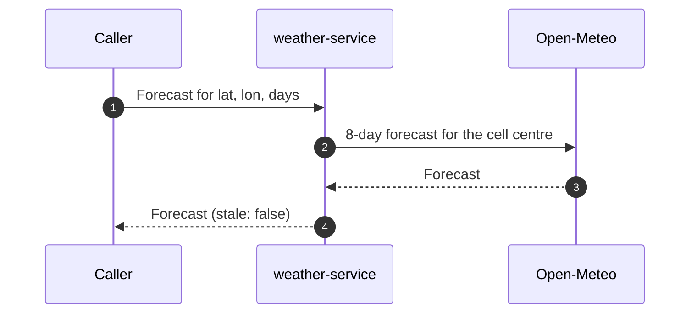
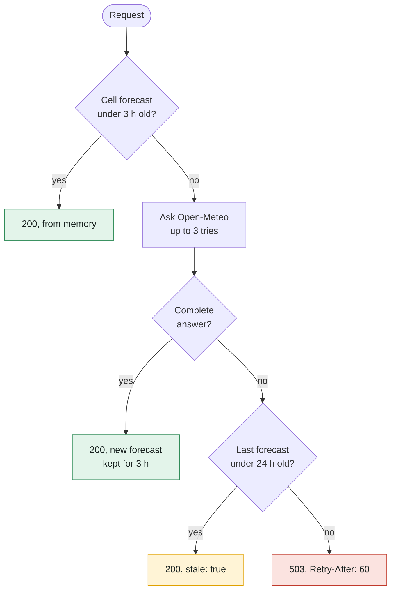

# weather-service

Daily weather for AgroPilot: for a point, the next 1–7 days of **ET0** (how much water a standard patch of grass loses to sun and wind, in mm) and **rain** (mm). It fetches the forecast from [Open-Meteo](https://open-meteo.com/en/docs) ("the provider"), keeps it in memory per 0.1° grid cell, and keeps answering when the provider fails. It knows coordinates and dates only, nothing about farms, plots or crops.

It never answers with a number the provider didn't give: no zeros, no defaults, no filled-in days. A forecast of zeros reads as "no water needed", the worst bug this system can have.

## Run

```bash
uv sync
cp .env.example .env
uv run uvicorn main:app --host 127.0.0.1 --port 8001
```

Interactive docs: http://127.0.0.1:8001/docs.

## Configuration

Read by `config.py` (pydantic-settings) from the environment or `.env` in this folder (a real environment variable wins). Every variable is required: if one is missing or invalid, the service stops at startup with a message naming it.

| Variable | Example | Meaning |
|---|---|---|
| `PROVIDER_BASE_URL` | `https://api.open-meteo.com` | Provider base URL (a paid plan uses a `customer-` host) |
| `PROVIDER_API_KEY` | *(empty)* | Must be present; may be empty on the free tier. Sent as `apikey` only when set |
| `PROVIDER_TIMEOUT_S` | `5` | Timeout per provider call, seconds |
| `PROVIDER_RETRIES` | `2` | Retries after the first failed call |
| `PROVIDER_RETRY_BACKOFF_S` | `0.5` | Wait between attempts, seconds |
| `FORECAST_FRESH_HOURS` | `3` | How long a forecast is fresh |
| `FORECAST_MAX_STALE_HOURS` | `24` | Oldest forecast still served as stale; at most 24 (see "Too old"), and not less than `FORECAST_FRESH_HOURS` |
| `RETRY_AFTER_S` | `60` | `Retry-After` header on `503` |

## What we take from Open-Meteo

One call: `GET {PROVIDER_BASE_URL}/v1/forecast?latitude=…&longitude=…&daily=et0_fao_evapotranspiration,precipitation_sum&timezone=auto&forecast_days=8`.

| Open-Meteo daily variable | Unit | Our field | Notes |
|---|---|---|---|
| `et0_fao_evapotranspiration` | mm (daily sum) | `et0_mm` | FAO-56 Penman-Monteith reference evapotranspiration of a well-watered grass surface |
| `precipitation_sum` | mm (daily sum) | `rain_mm` | Rain + showers + snowfall, as water |

- **Why `precipitation_sum`, not `rain_sum`:** Open-Meteo's `rain_sum` leaves out showers. Showers water a field like any rain, so `rain_sum` would undercount the water the field received and the planner would irrigate too much.
- **`timezone=auto`:** dates are the local calendar dates at the point, so "today" is the grower's today. The response's `utc_offset_seconds` is kept to know the local date later.
- **`forecast_days=8`:** one more than we ever serve; see "Too old" below.
- Open-Meteo's field names appear only in `provider.py`.

## Grid cells

A cell is a 0.1° square cut at 0.1° steps: 31.25 and 31.29 are in cell 31.2; 31.30 is in cell 31.3; −31.25 is in cell −31.3. `lat = 90` and `lon = 180` belong to the last cell (89.9, 179.9). Requests in the same cell share one forecast. The provider is always asked for the **cell centre** (cell + 0.05), so the forecast does not depend on which request came first. The response repeats the `lat`/`lon` the caller sent.

## Fresh, stale, too old

- **Fresh** (fetched less than 3 h ago) and covering the requested days: answered from memory, no provider call.
- **Not fresh:** call the provider, retrying twice (3 attempts, 0.5 s apart). On success the cell's forecast is replaced and the answer has `stale: false`.
- **Provider failure** is any of: timeout or connection error, error status, a body that isn't JSON, a missing field, arrays of different lengths, a `null`, a value that isn't a finite non-negative number, a bad or non-consecutive date, or too few days to cover today + 6. One bad day rejects the whole response; days are never patched.
- **All attempts failed:** answer with the cell's last forecast and `stale: true` (with its original `fetched_at`), if it is at most 24 h old and still covers the requested days. Otherwise `503`, `code: UNAVAILABLE`, `Retry-After: 60`.
- A failed fetch never changes or removes the cell's last good forecast.

### Too old: 24 hours

A forecast older than 24 hours is never served, not even as stale. Why:

- **It no longer describes today.** Open-Meteo refreshes its forecasts several times a day. A forecast older than a day has missed every update since, and serving it as if it described today's sun and wind risks a wrong irrigation decision. Past that point an honest `503` is better than an old guess, and the planner reports which service is down.
- **It still always has the whole week.** We fetch 8 days. A forecast up to 24 h old has crossed at most one local midnight, so it still covers today + 6 days, and a stale answer always has all 7 days the planner asks for, never a gap.

### Requests at the same time

At most one provider call cycle (attempt + retries) runs per cell at a time. A request that arrives while one is in flight for its cell waits for it and gets its outcome: the new forecast, or the same stale answer / `503`. So the longest wait is one cycle: 3 × 5 s timeout + 2 × 0.5 s ≈ **16 s** with the example settings. Callers (planner-service) must use a longer timeout than that. A fresh answer never waits, even while another cell's cycle is running.

Failures are not remembered (closest reading of FR-2.6): once a cycle has finished, the next request that finds no fresh forecast calls the provider again, with full retries.

### The flow in pictures

Normal request, when the cached forecast is too old:



How the answer is chosen:



## API

`GET /v1/forecast?lat={lat}&lon={lon}&days={days}`: `lat` −90…90, `lon` −180…180, `days` 1…7, all required.

```json
{
  "lat": 31.25,
  "lon": 34.79,
  "source": "open-meteo",
  "fetched_at": "2026-11-17T11:53:03Z",
  "stale": false,
  "days": [
    { "date": "2026-11-17", "et0_mm": 2.69, "rain_mm": 0.0 },
    { "date": "2026-11-18", "et0_mm": 2.67, "rain_mm": 0.0 },
    { "date": "2026-11-19", "et0_mm": 2.95, "rain_mm": 0.0 }
  ]
}
```

(`days=7` returns 7 entries.) Numbers are passed through as the provider gave them. `GET /health` returns `{"status": "ok"}` without calling the provider.

Every error is `application/problem+json` (RFC 9457) with a `code`:

| Status | `code` | When |
| --- | --- | --- |
| 422 | `VALIDATION` | `lat`, `lon` or `days` missing, not a number, or out of range |
| 404 | `NOT_FOUND` | Unknown route |
| 503 | `UNAVAILABLE` | Provider failed and no forecast at most 24 h old for that cell (sends `Retry-After`) |

## Performance

NFR-2.3: fresh forecast (no provider call), p95 ≤ 100 ms at 10 requests per second.

Measured 2026-11-17, `scripts/measure_latency.py --seconds 60` (cache warmed first, 600 requests over the 4 demo plots' coordinates): p50 6.4 ms, **p95 8.6 ms**, max 16.8 ms.

## Code layout

- `main.py`: the app, the startup config check, the routes
- `config.py`: settings
- `provider.py`: the Open-Meteo call and its validation (the only place with Open-Meteo field names)
- `forecast.py`: grid cells, the cache, fresh / stale / too-old rules, retries, one cycle per cell
- `problems.py`: problem+json errors (copied from registry-service; services never import each other)

## Test

```bash
uv run pytest
```

Tests never touch the network: the provider is faked with `httpx.MockTransport`, and the clock is injected.
